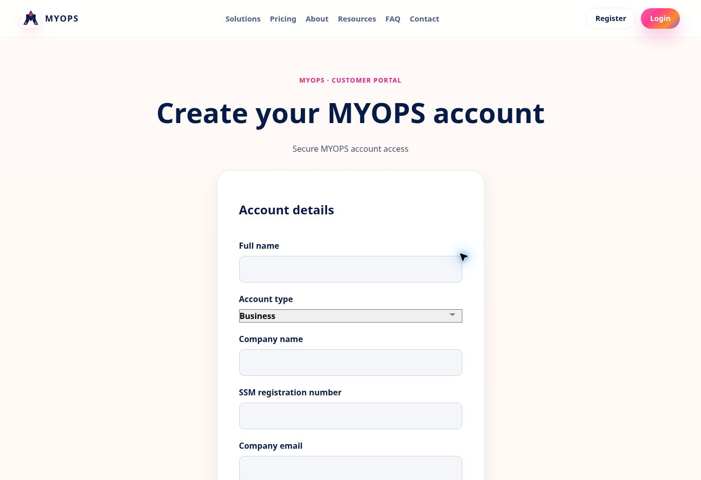

# Central registration/contact profile release — 7 November 2026 (Malaysia)

## Scope and released behavior
This is a partial delivery of item001, on the owner's continuing live-repair instruction. It does not certify the whole registration/email/profile-sync flow.
- Individual forms collect full name, email, contact number and address.
- Business forms additionally collect company name, SSM registration number, company email and person in charge. Existing account type values personal/business remain compatible.
- New registration requires complete contact fields at the server, even if the browser removes or downgrades profileVersion. Contact format, SSM character/length format, email and size/type/control-character checks are applied.
- Profile updates use only the descriptive allowlist. Role, organization, billing and subscription claims are not persisted from the body. Existing legacy partial updates preserve omitted metadata.
- Individual app launch labels can fall back to the registered individual name when no company name exists; no membership or entitlement is inferred.
- Data uses the existing MYOPS central Auth descriptive metadata path. The existing myops_profiles billing/account-type authority is not replaced or broadened. Company membership and application roles are unchanged.
- No logo upload or complete cross-app profile synchronization is implemented here. SSM format validation is not verification against SSM's registry.

## Exact release
Branch: fix/central-profile-contact-live
PR: https://github.com/niz262025-hub/southerndotcom-website/pull/38
Released code: cadc512c5f01f0d98f0f7425aaad8d54184d6ccf
Preview: https://southerndotcom-website-gu7vh6awy-mohd-syaiful-nizam1.vercel.app/register
Preview deployment: dpl_AUAvvvhFCXFM5ZTHN29tqjAqXg63, READY
Production deployment: dpl_CJfUQyvXFgTmUjNeRW7UUxdeJ4BD, READY
Live browser URL: https://www.myops.com.my/register
Production domain resolved to the released commit after promotion. Earlier homepage OpsFlow correction is preserved. No OpsHR/Finance/Flow/PS deployment changed in this release.

## Verification
| Check | Status | Evidence |
| --- | --- | --- |
| Full automated suite | PASS | 169 passed, 36 skipped, 0 failures; skips remain unexecuted. |
| ESLint and preview build | PASS | Both exit0. |
| Required-field enforcement at registration handler | PASS (automated) | Missing business/contact fields rejected before signUp, including without profileVersion. Valid company fields serialized through allowlist. |
| Invalid inputs | PASS (automated) | Malformed company email, short/non-numeric/overlong phone, bad SSM characters, oversized/type-invalid/control-character values rejected. |
| Account metadata read | PASS (automated) | Verified owner account returns bounded descriptive fields; role/organization claims excluded. |
| Existing customer compatibility | PASS (automated) | Existing read/legacy partial profile updates and original login/session/payment regression tests pass. Founder-account signup test fixture updated with the newly required fields; no production Founder policy change. |
| Preview Individual/Business switching | PASS (browser) | Personal fields shown initially; Business exposes required company name, SSM, company email, PIC, contact and business address. Required/max-length DOM attributes checked. |
| Production form render and switching | PASS (browser) | Actual live /register shows new Individual fields and Business fields after selection. No production form submission. |
| Production registration, email confirmation and profile save/readback | BLOCKED | No authenticated/new-account end-to-end persistence workflow executed in this follow-up. Unit contracts and visible form are not counted as this test passing. |
| Logo upload/update/remove/default | PENDING | Not implemented by this release. |
| All app profile propagation | PENDING | Only descriptive launch-name fallback changed. Existing app data was not rewritten and additional contact fields were not added to app payloads. |
| Mobile device UAT and live performance | NOT RUN | Do not infer from desktop form checks or build timing. |
| Error/fatal logs after deployment | No matching records | Exact new production deployment, previous10min. Sparse logs are not a zero-error guarantee. |

Full automated output: [log](uat-evidence/central-profile-tests-2026-11-07.log).

## Production database inspection and safety
Read-only Supabase inspection used the already connected account containing MYOPS-Central-Auth (uhuukcztdifvpjuopdea).
- myops_profiles columns: user_id, display_name, account_type, created_at.
- myops_organizations: id, name, owner_user_id, tier, seat_limit, created_at.
- Existing RLS enabled on profiles/organizations; self-read/member-read policies inspected. No policies or privileges changed. Existing table UPDATE grants alone do not imply row write access without a matching RLS policy.
- Existing central Auth metadata path extended for descriptive details; authorization remains server-owned.
- Supabase migration status: NONE. No schema/RLS/auth-secret/customer-data rewrite or infrastructure purchase.
- No actual customer profile, employee or transaction was submitted during browser checks.
- Android APK/native iOS/app-store work excluded.

## Rollback
Previous production deployment dpl_FeAjw7XSyrvmbPa84dQrg9vvhGwJ, code ea0920c7f8750e6c777fd5207e68d5e3284090d0.
Restore that deployment in the existing portal project if a regression appears, confirm www.myops.com.my points to it and recheck registration/login. Additive descriptive metadata must be retained if any customers have registered after release; do not delete user metadata to roll back UI code. No database rollback is required.

## Current recommendation
Keep the limited released forms/validation change, but item001 remains incomplete pending real persistence/verification UAT, optional company logo and full subscribed-app profile synchronization. OpsHR V1, four languages and seven-day trial remain separate unfinished items from the master audit.

