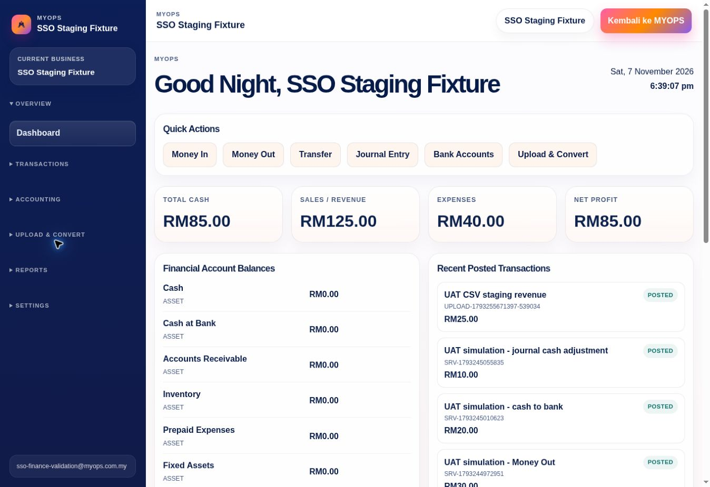
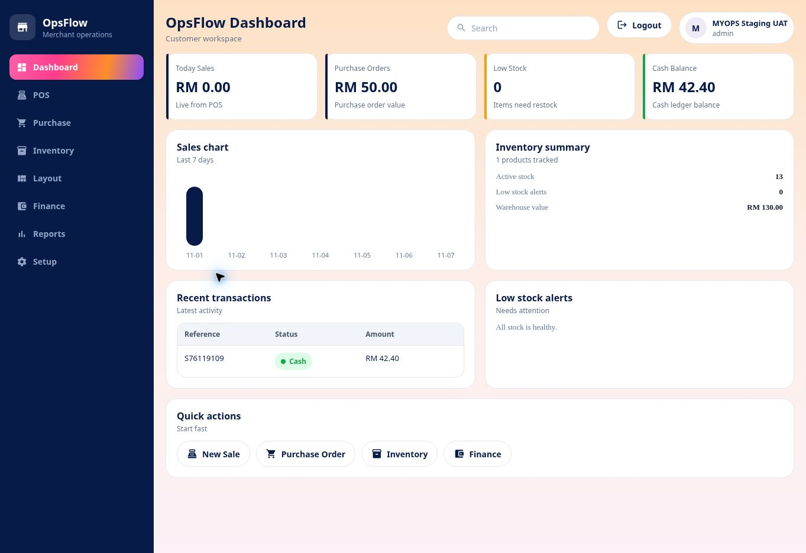

# Central entitlement request snapshot — 7 November 2026

Status: automated checks PASS; authenticated MYOPS → Finance → MYOPS → Flow desktop smoke UAT PASS in the follow-up below. Actual page timing, mobile coverage and full application UAT remain unverified. Production not promoted.

## Change
The isolated staging entitlement endpoint previously loaded the entitlement tables once for access and again to distinguish paid from trial access. Trial-only users also loaded the eligible trial a second time. The endpoint now calculates paid and trial states from one fresh request-local snapshot. No cross-request cache is introduced. Normal paid-only release source does not contain this staging trial duplication, so its server source is unchanged.

For an individual trial-enabled entitlement request: product, personal subscription, membership, grant and lifetime reads fall from two each to one each; trial reads fall from two to one (12 reads to 6). Organization subscriptions and organization-trial eligibility retain their existing membership/owner checks. These are query-count assertions, not measured website latency.

## Evidence
- Full isolated-stage suite: 171 PASS, 36 SKIP, 0 FAIL (207 total).
- Entitlement suite: 24 PASS, including new default-resolver request tests.
- ESLint PASS and preview build PASS.
- Tests cover fresh reads on successive requests, trial-to-paid transition, expiry/revocation, lookup failures failing closed without revocation, company isolation and Coming Soon denial.
- Existing signature, nonce, rate limits, idle-session checks and polling-without-touch regression tests pass.
- Evidence log: [staging automated output](https://github.com/niz262025-hub/southerndotcom-website/blob/4de726d79a189fa2b3f9a80d8fe69f6f2d3fdab9/docs/uat-evidence/central-snapshot-tests-2026-11-07.log).
- No schema migration, customer data write, infrastructure purchase or native mobile change.

## Validation still required
Authenticated MYOPS → Finance/Flow preview launch, paid/trial behavior, desktop/mobile navigation and end-to-end dashboard timing. Remote browser last redirected to the MYOPS login; no authenticated page-speed result is claimed.

## Deployment and rollback
Apply only on feat/myops-isolated-staging; renew deployment-bound central preview access transport for Finance and Flow after the new preview is READY, then redeploy those preview branches. OpsPS Edge Function preview transport remains separately blocked. No production domains or production environment variables may be changed.
Rollback the two source/test files to parent 183a957392ca09788a572e5ec4c2274c68a779c9, rebuild the central preview, renew its preview transport and redeploy dependent previews. No database rollback required.

## Rerun deployment evidence
- Source commit: 4de726d79a189fa2b3f9a80d8fe69f6f2d3fdab9 on isolated staging.
- MYOPS preview READY: https://southerndotcom-website-k8axmskki-mohd-syaiful-nizam1.vercel.app (dpl_48HWJPkqVMnRq9jBgqwPZQD3bz1L).
- Finance preview READY: https://opsfinance-p4r9p4f5l-mohd-syaiful-nizam1.vercel.app (dpl_BZoWwKHUS3Z1fBETSPkUddff25r7), source 7d01eeaa52f894bef5fb99afbda92e3e939d1d11.
- Finance full staging suite rerun: 312 PASS, 1 SKIP, 0 FAIL; 63 passed test files, 1 skipped; 31.77 seconds runner duration (not page loading).
- Flow preview READY: https://opsflow-staging-ovajvwkqv-mohd-syaiful-nizam1.vercel.app (dpl_HaeSZhwWHTdAHah5WG7q5DVgQ2Yd). Staging branch alias reassigned to this deployment.
- Existing branch-scoped Finance and Flow preview transport variables refreshed; production variables untouched.
- Flow branch-alias /api/sso-ready: HTTP 200, {"ready":true,"signed_transport":"verified","unknown_session":"denied"}. This verifies signed central transport and denial of an unknown session; it does not prove a successful entitled-user launch.
- Finance unauthenticated protected-data HTTP check could not be conclusively classified: Vercel connector reported deployment authentication required (401). Do not count it as a passed application authorization test.
- Actual signed-in dashboard speed, mobile UAT and full cross-app positive-session tests remain BLOCKED; production readiness not approved.

## Follow-up: browser session blocker resolved

The remote browser now had a valid central session. No credential reset, session-timeout relaxation, entitlement bypass or additional code change was required to resolve this test-session blocker.

| Test | Result | Observed evidence |
| --- | --- | --- |
| MYOPS account and active application access | PASS | Central account displayed active Finance, Flow and OpsPS access. |
| MYOPS → Finance launch through central SSO | PASS | Finance /launch proceeded to /dashboard without another sign-in. |
| Finance dashboard values on optimized staging source | PASS | Existing fixture: cash RM85, revenue RM125, expenses RM40, net profit RM85; bank ledger RM45, cash ledger RM40. Recent posted values RM25/RM10/RM20/RM30/RM100. |
| Finance Money In navigation/data load | PASS | /transactions/money-in opened; today's date, blank amount/reference/description and explicit account placeholders; available financial/ledger options and five existing transaction rows loaded. No posting submitted. |
| Finance desktop page overflow | PASS (single viewport only) | DOM document width and viewport width both 1363 CSS pixels. This is not mobile evidence. |
| Finance → MYOPS return | PASS | Returned to central /dashboard with existing session and Open App actions. |
| MYOPS → Flow launch through central SSO | PASS | Flow /app displayed MYOPS Staging UAT and admin role without another login. |
| Flow dashboard data render | PASS | Existing purchase RM50, cash RM42.40, stock 13, warehouse value RM130, recent cash RM42.40. Rendering checked only; no reconciliation certification. |
| Under-two-second dashboard / under-one-second transitions | UNVERIFIED | Browser read-only scope exposes DOM but not performance API. UI action timings include automation/network overhead; no valid website timing claimed. |
| Android/iPhone/tablet | NOT RUN in this follow-up | Desktop cloud viewport only. |
| Full OpsPS, OpsHR, trial and cross-app regressions | PENDING | These smoke tests do not certify remaining programme items. |

Earlier paragraphs describing a missing remote browser session are historical and superseded by this follow-up. Previously skipped automated tests remain skipped, not passed. No customer or fixture transactions/profile fields were changed. No Supabase migration or production deployment was performed. Native Android/iOS development remains excluded.

### Browser evidence

