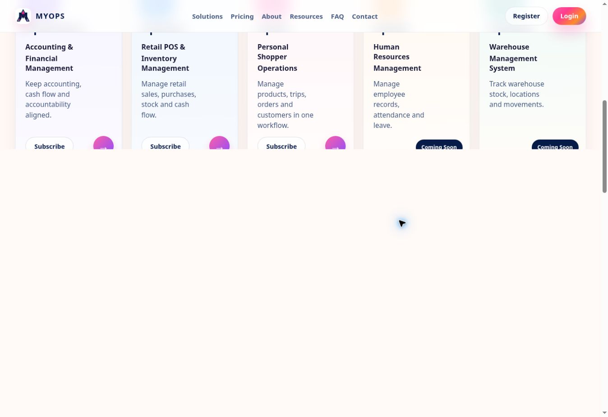
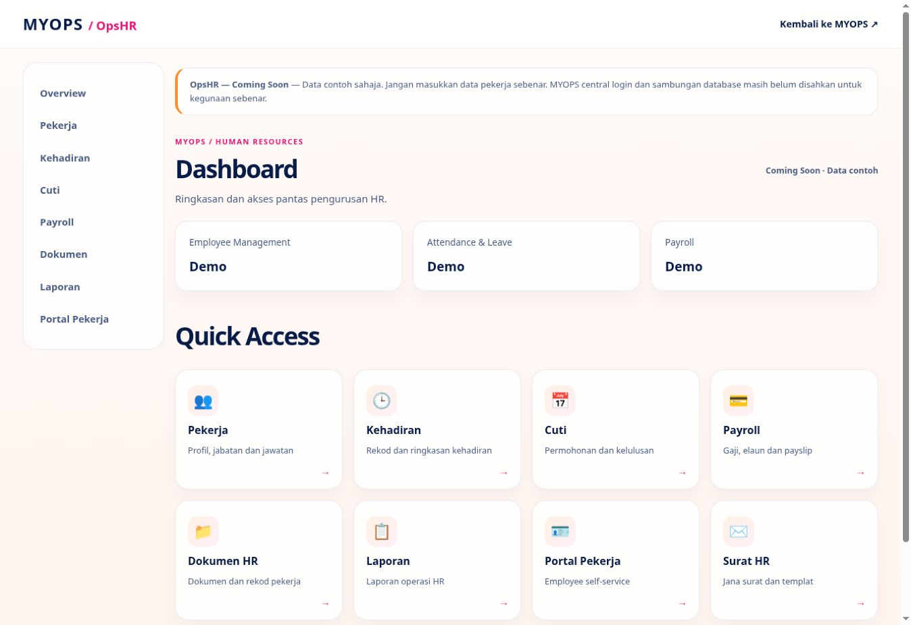

# MYOPS live web audit and first controlled repairs — 7 November 2026 (Malaysia)

## Outcome and scope
Live audit executed against the existing production domains. Two limited repairs were tested in development branches, verified in previews, deployed using production configuration, and checked on the actual live domains. This report does **not** certify the nine-item programme or OpsHR V1 as complete.

Latest owner instruction: audit and repair live web including OpsHR. That instruction authorized these controlled production changes; no production credential, database migration, billing setting or customer record was changed.

## Production inventory
| Application | Live URL | Audited production baseline | Result |
| --- | --- | --- | --- |
| MYOPS | https://www.myops.com.my/ | 71cbb0f8c0a35faf3995e5ecc7c4b2c0c05abfff | Loads; original homepage preserved. OpsFlow copy corrected by this release. |
| Finance | https://app.myops.com.my/dashboard | 1bbd75c2d86ea68d1c75a4babeb1290d9e523482 | Unauthenticated direct access redirected to MYOPS /login. No authenticated functional PASS claimed. |
| Flow | https://opsflow.myops.com.my/app | 99cf601aa6d7f639561059ca92f90031128fe538 | Unauthenticated access returned to MYOPS homepage. No authenticated POS UAT claimed. |
| OpsPS | https://opsp-mobile-r1.vercel.app/ | 4ce533e89426d997cf1dd52af6af8a9faba46800 | Unauthenticated access returned to MYOPS homepage. No authenticated trip UAT claimed. |
| OpsHR | https://opshr.vercel.app/ | b40e109234ff495f462b93897a84ebfd6d4f1199 | Production URL serves synthetic demo modules. It is not a functional production HR service. |
| OpsWMS | MYOPS application card | Central catalogue/visible card | Coming Soon remains visible; no WMS release attempted. |

## Released changes
- MYOPS: correct OpsFlow application card, solution description and metadata to retail POS, purchasing, inventory and cash flow. Six text lines changed. Preserve homepage markup, artwork, colors, registration, SSO, billing and application routing.
- OpsHR: add a collapsible native menu for narrow viewports; retain desktop left navigation; give header full available width; allow content/action wrapping; keep touch-friendly menu links. Retain approved dashboard, Quick Access cards, synthetic data warning and closed approval endpoint.
- OpsHR availability now says Coming Soon / Data contoh instead of development-preview labels. This does not enable unfinished HR workflows.
- Dependency lockfile included in reviewed source tree; no new service or infrastructure.

## Branches, PRs and exact builds
Both repair branches: fix/live-web-audit-20261107.
- Portal PR: https://github.com/niz262025-hub/southerndotcom-website/pull/37
- OpsHR PR: https://github.com/niz262025-hub/OPSHR/pull/25
PRs remain open; production was built from the exact reviewed repair commits, without merging unrelated development work.

| Application | Released commit | Preview | Production |
| --- | --- | --- | --- |
| MYOPS | ea0920c7f8750e6c777fd5207e68d5e3284090d0 | dpl_E5ZestBZ3aY479Khj3vQ8o2DxMnN READY | dpl_FeAjw7XSyrvmbPa84dQrg9vvhGwJ READY, www.myops.com.my resolves to this build |
| OpsHR | 52a97a549d7faf121fd309f0dbd1564e90b4016a | dpl_Fapk4Btjr7rZu1KVAqCtCJdCShVG READY | dpl_5VG7KdrVn8NFSp2ue4exPd7ViB7n READY, opshr.vercel.app resolves to this build |

Preview URLs:
- https://southerndotcom-website-1xlqd00zt-mohd-syaiful-nizam1.vercel.app/
- https://opshr-kzthdimli-mohd-syaiful-nizam1.vercel.app/
- OpsHR narrow-viewport test harness: https://opshr-ruru3pqts-mohd-syaiful-nizam1.vercel.app/uat-responsive
Harness commit 494dc215242d342e59756dd820e2df70f8cfc7d4 adds only a preview-only audit route on top of released OpsHR code. That route was not included in the production release.

## Executed tests
| Check | Status | Evidence |
| --- | --- | --- |
| Portal full automated suite | PASS | 161 passed, 36 skipped, 0 failed; skips are not passes. |
| Portal lint and preview build | PASS | Both exit 0. |
| OpsHR automated suite | PASS | 68 passed, 0 failed, 0 skipped. These unit tests do not prove persistent live HR workflows. |
| OpsHR TypeScript/build | PASS | Both exit 0; existing CSS autoprefixer warning remains. |
| Preview portal | PASS | Correct retail POS copy, original homepage artwork/structure visible. |
| Preview OpsHR desktop | PASS | Dashboard, left menu and Quick Access preserved; corrected full-width header. |
| OpsHR narrow dashboard layouts | PASS (Chrome iframe layout checks) | Nominal iframe widths 320/390/768; observed usable document widths 305/375/753 due to vertical scrollbars. Document scrollWidth equals clientWidth in each. |
| OpsHR mobile menu navigation | PASS (305 CSS px) | Menu opened, links displayed, Pekerja opened in the narrow iframe. |
| OpsHR narrow employee list | PASS (305 CSS px, layout only) | Document width 305, scrollWidth 305; wide table retained inside local scroll container. |
| OpsHR narrow employee dialog | PASS (layout only) | Add-example dialog opened; left18/right287/width269; inner clientWidth and scrollWidth both252. Cancelled without saving. |
| Physical Android/iPhone/Safari | BLOCKED | No real-device or Safari session available in this run; iframe checks are not device certification. |
| Post-release MYOPS live | PASS (limited smoke) | Actual www domain shows corrected OpsFlow copy, original homepage and Register/Login controls. |
| Post-release OpsHR live | PASS (limited smoke) | Actual opshr.vercel.app shows updated header, dashboard, Quick Access and truthful unreleased status. |
| Recent production error-log query | No matching records | Exact new deployment IDs, error/fatal, previous15min; this is not a guarantee that no errors exist. |
| Authenticated production business UAT | BLOCKED | Browser had no authenticated production MYOPS session; no customer records or transactions submitted. Prior staging passes were not relabelled as live passes. |

## Nine-item status after this release
| Item | Status | Outstanding evidence or work |
| --- | --- | --- |
| 001 Registration/profile | FAIL (incomplete live requirements) | Live register business selection still lacks SSM, contact, address, PIC and logo workflow. Central sync and logo defaults need implementation/verification. |
| 002 Finance redesign | BLOCKED | Authenticated live dashboard, illustration, all cards/forms and routes not audited in this run. Earlier optimized Finance source is still separate preview work. |
| 003 Four languages | FAIL (incomplete visible interfaces) | No common four-language selector on audited public portal/OpsHR surfaces. Full coverage and central preference remain pending. |
| 004 Performance | BLOCKED | No valid before/after live dashboard timing. Existing CPU fixture benchmarks are not live page measurements. |
| 005 Navigation/logout | BLOCKED | OpsHR layout improved; consistent single central sign-out and idle expiry across authenticated production apps remain unverified. |
| 006 Verification/autologin | BLOCKED | No production email verification and automatic-login flow executed. |
| 007 Responsiveness | BLOCKED (partial PASS for OpsHR) | Narrow OpsHR dashboard/menu/list/dialog checked; authenticated Finance/Flow/PS and real Android/iPhone/tablet coverage pending. |
| 008 SSO/subscription | BLOCKED (partial PASS for anonymous redirects) | Anonymous redirects observed for Finance/Flow/PS. Positive-session entitlement, organization roles, revocation and OpsHR central integration remain pending. |
| 009 Seven-day trial | FAIL (not visible on audited public homepage) | Activation, trial count, transaction limits and upgrade/expiry enforcement need production implementation and UAT. No false trial CTA added. |

## OpsHR V1 readiness
Employee UI uses in-memory synthetic records. Attendance, leave, payroll, documents and reports are demo surfaces; server approval route explicitly remains closed without trusted actor/repository dependencies. No central launch implementation was introduced by this layout release. Persistent tenant-scoped CRUD, role-controlled leave/payroll/document workflows and MYOPS SSO must be completed and tested before real employee/payroll data is accepted. Keep OpsWMS Coming Soon.

## Database, rollback and release recommendation
- Supabase migration status: NONE in this release. No schema, RLS, customer data, authentication secret or entitlement changed; no database rollback required.
- Portal rollback baseline: dpl_FAqxWU7ArhnXAQagerZLBfMDh22p (commit71cbb0f8c0a35faf3995e5ecc7c4b2c0c05abfff).
- OpsHR rollback baseline: dpl_J2HW3ZiNErvbZbabwBYoJwwW3EeD (commitb40e109234ff495f462b93897a84ebfd6d4f1199).
- If a regression appears, restore the relevant previous production deployment in the same existing project, verify its domain target and repeat affected smoke checks.
- Keep these limited fixes live; do not advertise the full ecosystem or OpsHR V1 as fully passed. Preserve repair commits when merging future production branches to avoid reverting the fixes.
- Android APK, native Android/iOS and app-store changes were excluded. No paid infrastructure added.

## Screenshots

