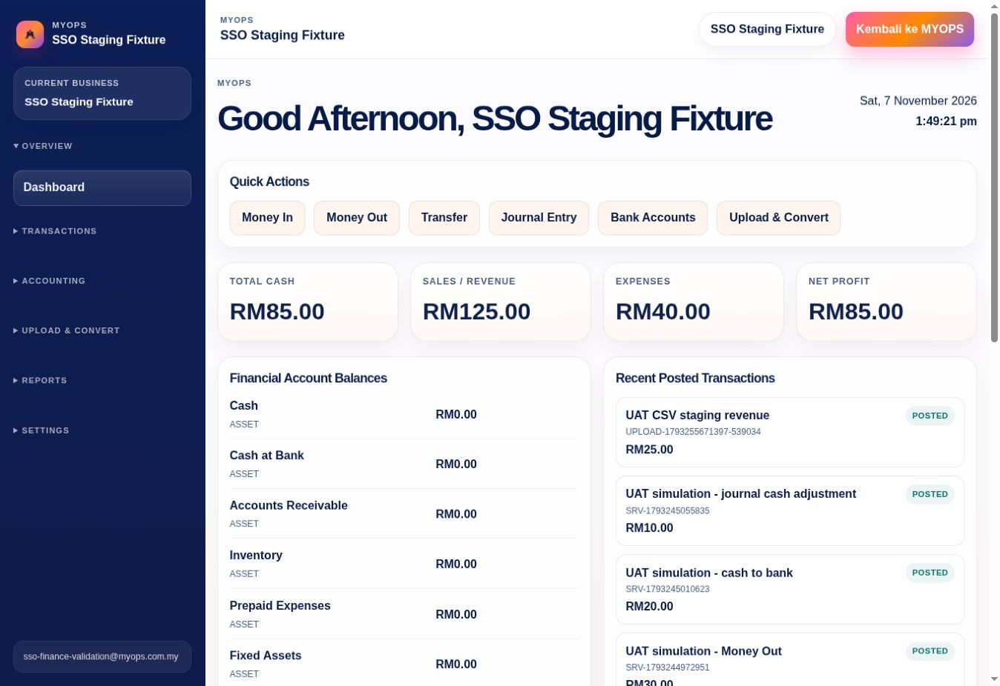

# MYOPS web repair rerun — 7 November 2026

Status: automated rerun completed; authenticated Finance browser acceptance passed for the limited scenarios below. OpsFlow launch recovered and was verified in browser; OpsPS launch remains blocked after a confirmed preview transport failure. Production release remains NOT READY.

## Latest continuation — Finance entry and portal copy

This continuation changes two development PRs and their configured isolated UAT branches. Production remains NOT READY. These checks do not complete all nine items or OpsHR V1.

- Finance dashboard now has six Quick Actions to existing Money In, Money Out, Transfer, Journal Entry, Bank Accounts and Upload & Convert routes, with wrapping and 44px minimum touch height. No new route or accounting calculation was added.
- Dashboard panels, account names, financial values and recent-transaction references can shrink/wrap within narrow containers. Real Android/iPhone/tablet UAT is still BLOCKED; CSS alone is not a PASS.
- Browser UAT exposed fixed development defaults in the real transaction form: 5 October, RM100, Real DB posting and UI-POST-001. The form now starts with the user's local current date and blank amount/description/reference. Accounts require explicit selection. Client validation rejects missing accounts/date/description, zero/negative/non-numeric amounts and more than two decimal places. Server authorization/accounting validation is unchanged.
- Posting has an in-flight guard and disabled pending button. Failed API responses retain input for retry; successful posting clears amount, description and reference. Pending/failure/success behavior was verified with a mocked API, not a new database posting.
- MYOPS homepage/product copy, metadata and account-preview copy now describe OpsFlow correctly as Retail POS, inventory, purchases and cash flow. Homepage structure, CSS and artwork are unchanged.

| Current check | Result | Evidence / limit |
| --- | --- | --- |
| Portal automated suite | PASS, 168; SKIP, 36 | Isolated UAT worktree; npm test, lint and preview Vite build passed |
| Finance focused regression | PASS, 18 | Nine form safety tests, seven accounting workflow tests and two dashboard-total tests; [execution log](./uat-evidence/finance-entry-regression-2026-11-07.log) |
| Finance TypeScript | PASS | npm run typecheck exited zero |
| Finance exact preview build | PASS | Vercel READY on stage commit 8a290871c778174e546caec9ada9e51a45619cbd |
| Finance current full-suite rerun | NOT COUNTED | Attempt exited zero but log lacked a final suite summary. Earlier 688-pass record below is historical; no new full-suite count is claimed |
| New portal → Finance SSO | PASS | Current central preview opened Finance /dashboard without a second login |
| Quick Actions and financial summary | PASS, limited | Six links visible; totals remain RM85 cash / RM125 revenue / RM40 expenses / RM85 profit; recent RM25/RM10/RM20/RM30/RM100 retained |
| Money In entry validation | PASS | Date 2026-11-07 and blank entry fields; no preselected accounts. Empty form displayed account guidance; 0.001 displayed decimal-place guidance before posting |
| Money Out / Transfer route entry | PASS, limited | Correct transaction type, current date and blank inputs appeared. No new posting, transfer or financial operation was submitted |
| OpsFlow public copy | PASS | Current homepage and /solutions/opsflow display the corrected retail description and four product capabilities |
| Current OpsFlow signed transport | PASS, API only | Renewed preview returned 200, signed_transport=verified, unknown_session=denied; prior authenticated browser launch is recorded below |
| Page-transition performance | UNMET / investigation open | One Money Out navigation exceeded a 10-second URL wait, then loaded. This is an uncontrolled preview observation, not an agreed reproducible performance benchmark |
| OpsPS secret / SSO | BLOCKED | Owner is on a phone and cannot complete the browser credential-change handoff. No secret value was entered or saved |

Finance PR source: 1f235333154c68cea8f298de768d333e9e58011f, [PR 37](https://github.com/niz262025-hub/OpsFinance/pull/37). UAT source: 8a290871c778174e546caec9ada9e51a45619cbd. READY preview: https://opsfinance-n34n5fpfk-mohd-syaiful-nizam1.vercel.app (dpl_AxjjjqwGU4z8UDRKHVFjy6RowSnW).

Portal PR source: 30485be92d3212e4f3c3d5f6323762667f37bc69, [PR 36](https://github.com/niz262025-hub/southerndotcom-website/pull/36). UAT source: 183a957392ca09788a572e5ec4c2274c68a779c9. READY preview: https://southerndotcom-website-fvrwwbai0-mohd-syaiful-nizam1.vercel.app (dpl_9ot5LtPhrjQ18DvfAkw3emaSsMbv).

Existing Finance/Flow preview-only transport authorization was renewed after the central rebuild. Flow READY preview dpl_BrwfZ7xUPC53ohNRwh8d4ymwfxoL uses unchanged source b4325468a861d828a951baf7e30c6f491928faaf; only its existing staging branch alias was reassigned. No production alias/environment, schema, migration, customer data, paid service or native mobile build changed.

## Earlier full automated verification

| Repository / source scope | PASS | SKIP | FAIL | Other checks |
| --- | ---: | ---: | ---: | --- |
| MYOPS isolated staging with registration repairs | 168 | 36 | 0 | lint and preview-mode Vite build passed |
| OpsFinance isolated staging with dashboard correction | 293 | 1 | 0 | TypeScript and Next build passed |
| OpsFlow master web repair worktree | 28 | 0 | 0 | TypeScript passed |
| OpsPS master web repair worktree | 199 | 0 | 0 | TypeScript passed |
| Total | 688 | 37 | 0 | Counts are this rerun only |

These are automated tests, not 688 browser UAT cases. The earlier 698 count used a different Finance source base and is not added to these results. OpsHR and full six-app acceptance are not included.

Commands: `npm test` in each listed worktree; `npm run typecheck` for Finance/OpsPS; `npx tsc --noEmit` for OpsFlow; MYOPS `npm run lint` and `VERCEL_ENV=preview npm run build`; Finance `npm run build`.

## Confirmed defect and controlled correction

The prior authenticated browser UAT displayed nonzero financial summaries but RM0.00 for balanced posted journals in Recent Posted Transactions. The old staging implementation subtracted credits from debits, so a balanced journal became zero. It also calculated dashboard totals from only six recent rows.

The staging correction now reads all posted journals in deterministic 500-row pages for the active business, calculates summary totals from that complete dataset, and displays only six recent rows. Recent transaction amount uses the journal's debit total. A later-page error prevents partial totals from being shown.

Regression tests prove correct totals for 1,001 posted journals, six recent rows with nonzero receipt amounts, and failure handling when a later page fails. No journal, balance or customer record was modified by this correction.

Source: https://github.com/niz262025-hub/OpsFinance/commit/81c1860f2c36b8ba7e050b7e56167b28e3ba1137
Branch: `feat/myops-launch-session-bridge`.
Vercel: `dpl_DRYKVWLk9UTrpRcSsHoCJen5H3Fy`, READY, preview target only.
Preview: https://opsfinance-faqdwxb7f-mohd-syaiful-nizam1.vercel.app

## Browser acceptance evidence

| Check | Status | Evidence / limit |
| --- | --- | --- |
| Fresh owner-completed central login | PASS | MYOPS displayed My Account/Admin and app launch controls on 7 November 2026 |
| Fresh MYOPS → OpsFinance SSO launch | PASS | Open App reached Finance /dashboard without a second login |
| Finance shell | PASS, limited | Registered fixture name, collapsible Reports menu, time greeting and live clock appeared |
| Corrected Recent Transactions | PASS | Browser displayed RM25, RM10, RM20, RM30 and RM100 for the five persisted fixture journals |
| Dashboard → P&L reconciliation | PASS | Both displayed revenue RM125.00, expenses RM40.00, net profit RM85.00; report dates 1–31 October 2026 |
| Selected-account General Ledger | PASS | UAT Bank Ledger showed two rows and closing RM45.00; switching to UAT Cash Ledger showed four rows and closing RM40.00. Combined RM85.00 matches dashboard cash |
| Unauthenticated protected account | PASS, prior negative check | /account returned to central /login without account details |
| MYOPS → OpsFlow | PASS, recovered | Initial launch failed; preview transport renewed and existing staging branch alias reassigned from old dpl_Huxr8wxezSiAh4m6D7GjVj796AEj to READY preview dpl_4LcrEVn1VYbQsvczpdhWZatMwWPs. New deployment readiness returned 200, signed_transport=verified, unknown_session=denied. Fresh MYOPS launch reached /app without a second login |
| OpsFlow dashboard → Finance read | PASS, limited | Existing fixture dashboard cash balance RM42.40 matched Finance cash flow RM42.40; purchase orders RM50, stock 13 units and warehouse value RM130 appeared. No sale/payment writes or full reconciliation were performed |
| MYOPS → OpsPS | FAIL / repair BLOCKED | Launch page displayed “OpsPS tak dapat dibuka”. Shared staging project ojamkplflqafedmxbdxb, myops-app-access v17 logs at 05:18:28 UTC show POST 503 and Staging redirect rejected. Available connector cannot update Edge Function secrets. Owner subsequently authorized browser access and Supabase sign-in succeeded; the current preview share token was prepared privately in the remote browser clipboard and only the MYOPS_STAGING_SHARE_TOKEN name was entered. No value was entered or saved. Browser credential-change handoff requires owner input; owner is on a phone and cannot control the remote browser, so the credential update is deferred. No token is included in this report |
| Mobile/tablet, trial/expiry, global logout, OpsHR | BLOCKED / incomplete | No new acceptance evidence for these scenarios |

Authenticated evidence uses the existing synthetic SSO Staging Fixture account and its persisted UAT records. No journal or customer data was written in these browser checks. The earlier secure login timeout was resolved by owner-completed login; no credentials were inspected or logged. Keep the 15-minute inactivity timeout.

Browser screenshot: Finance P&L viewport captured on 7 November 2026, with the fixture label and RM125/RM40/RM85 reconciliation visible. This does not prove all accounting workflows, tenant isolation, performance targets or responsive acceptance.

## Deployment / data safety

- No production promotion, production alias assignment or production branch merge. Only the existing OpsFlow staging branch alias was repointed to its verified renewed preview; source b4325468a861d828a951baf7e30c6f491928faaf is unchanged. This preview does not include the master PR mobile patch.
- No Supabase migration or customer-data mutation.
- No new infrastructure, paid service, Android APK, iOS native build or store configuration.
- Existing four master repair PRs remain draft: MYOPS #36, Finance #37, OpsFlow #7, OpsPS #9.
- The staged correction already exists in the Finance master release candidate; this commit aligns the older configured UAT branch.

Next gate: repair and retest isolated OpsPS SSO transport, then continue business-function, mobile, negative authorization and remaining ordered UAT. No production approval is requested.
